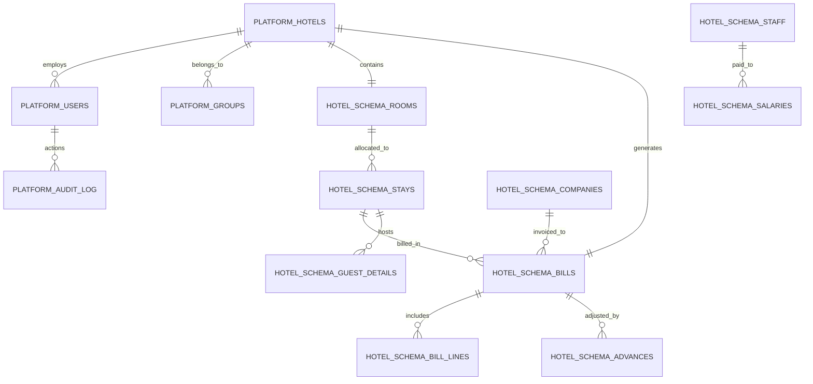

# 11. Database Schema & Entity Relationship Diagram (ERD)

HMS utilizes **PostgreSQL 18** with a total of **213 unique tables** split across two architectural tiers:
1. **Platform Schema (`platform.*`)**: 112 tables managing global multi-tenancy, cross-hotel profiles, authentication, security events, and audit logs.
2. **Hotel Tenant Schemas (`hotel_<hotel_id>.*`)**: 101 tables replicating the private operational state of each hotel property.

---

## 1. Entity Relationship Diagram (High-Level Multi-Tenant Architecture)

---

## 2. Platform Schema Core Tables (`platform.*`)

### `platform.hotels`
Master directory of onboarded hotel properties:
- `id` (VARCHAR(32), Primary Key): UUID or unique hotel identifier.
- `name` (TEXT, Not Null): Commercial name of the hotel (e.g., "Hotel Pallav").
- `slug` (TEXT, Unique): URL-friendly slug used for public website and booking routes.
- `schema_name` (TEXT, Unique): Exact PostgreSQL schema name (e.g., `hotel_pallav` or `hotel_01a...`).
- `group_id` (VARCHAR(32), Foreign Key -> `platform.groups.id`, Nullable): Parent group.
- `status` (TEXT): `active`, `provisioning`, `suspended`, `archived`.
- `created_at` (TIMESTAMPTZ): Registration timestamp.

### `platform.users`
Universal user identity store:
- `id` (VARCHAR(32), Primary Key): User UUID.
- `hotel_id` (VARCHAR(32), Foreign Key -> `platform.hotels.id`, Nullable): Associated hotel (null for Super Admins).
- `username` (TEXT, Unique, Nullable): Login username.
- `email` (TEXT, Unique, Not Null): Primary email address.
- `phone` (TEXT, Nullable): Contact phone number.
- `password_hash` (TEXT, Not Null): Argon2id password hash.
- `role` (TEXT, Not Null): `super_admin`, `platform_admin`, `group_hotel_admin`, `hotel_admin`, `hotel_user`, `corporate_user`, `guest_user`.
- `is_active` (BOOLEAN, Default True): Account active flag.
- `temporary_password` (BOOLEAN, Default False): Forces password change on initial login.
- `failed_login_count` (INTEGER, Default 0): Incremented on wrong password (locks at 5).
- `locked_until` (TIMESTAMPTZ, Nullable): Temporary lockout timestamp.

### `platform.vault`
Hardware/Platform security credentials storage:
- `id` (VARCHAR(32), Primary Key).
- `hotel_id` (VARCHAR(32), Foreign Key -> `platform.hotels.id`).
- `category` (TEXT): `razorpay`, `smtp`, `google_oauth`, `storage`.
- `encrypted_secret` (TEXT): AES-256-GCM encrypted ciphertext.
- `iv` (TEXT): Initialization vector.
- `auth_tag` (TEXT): Authentication verification tag.
- `updated_at` (TIMESTAMPTZ).

### `platform.security_events`
Real-time incident log (Warning & Critical alerts):
- `id` (VARCHAR(32), Primary Key).
- `severity` (TEXT): `warning`, `critical`.
- `event_type` (TEXT): `failed_login_lockout`, `canary_key_triggered`, `honeypot_hit`, `cross_tenant_violation`.
- `details` (JSONB): IP address, user-agent, triggered route, and tenant context.
- `created_at` (TIMESTAMPTZ).

---

## 3. Hotel Schema Core Tables (`hotel_<hotel_id>.*`)

### `rooms`
Room status and inventory:
- `id` (VARCHAR(32), Primary Key).
- `number` (TEXT, Unique): Physical room number (e.g., "101", "204B").
- `floor` (INTEGER): Floor level.
- `category_id` (VARCHAR(32)): Room type (Deluxe, Executive, Suite).
- `status` (TEXT): `vacant_clean`, `vacant_dirty`, `occupied`, `maintenance`.
- `base_rate_paise` (BIGINT): Standard rack rate per night in paise.

### `stays`
In-house guest stay records:
- `id` (VARCHAR(32), Primary Key).
- `room_id` (VARCHAR(32), Foreign Key -> `rooms.id`).
- `reservation_id` (VARCHAR(32), Nullable).
- `guest_name` (TEXT, Not Null).
- `guest_mobile` (TEXT, Not Null).
- `check_in_time` (TIMESTAMPTZ).
- `expected_check_out` (TIMESTAMPTZ).
- `actual_check_out` (TIMESTAMPTZ, Nullable).
- `food_plan` (TEXT): `EP`, `CP`, `MAP`, `AP`.
- `rate_per_day_paise` (BIGINT).
- `status` (TEXT): `checked_in`, `checked_out`, `transferred`.

### `bills`
Tax invoices and guest folios:
- `id` (VARCHAR(32), Primary Key).
- `bill_number` (TEXT, Unique): Formal sequential invoice number (e.g., `INV-2026-0012`).
- `stay_id` (VARCHAR(32), Foreign Key -> `stays.id`, Nullable).
- `company_id` (VARCHAR(32), Nullable): Associated corporate account for billing.
- `subtotal_paise` (BIGINT): Base room and food charges.
- `discount_paise` (BIGINT, Default 0).
- `cgst_paise` (BIGINT): Central GST component.
- `sgst_paise` (BIGINT): State GST component.
- `total_paise` (BIGINT): Total invoice liability.
- `advance_adjusted_paise` (BIGINT, Default 0): Amount deducted from prior deposits.
- `net_paid_paise` (BIGINT): Net payment collected at settlement.
- `status` (TEXT): `draft`, `settled`, `debit`, `cancelled`.
- `settled_at` (TIMESTAMPTZ, Nullable).
