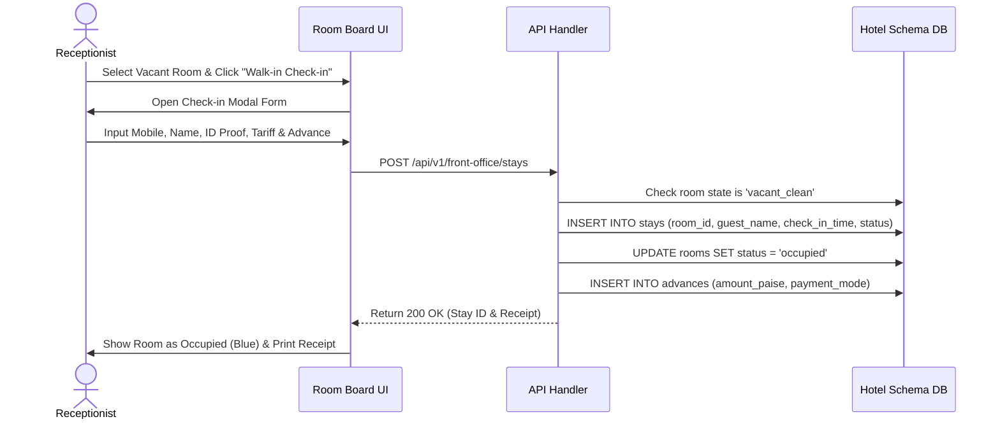

# 14. Business Logic & Core Workflows

## 1. Walk-in Guest Check-In Workflow

---

## 2. Invoicing & Bill Settlement Workflow

1. **Charge Accumulation**: During the stay, charges accumulate:
   - Daily room tariff applied automatically by the system.
   - Restaurant dining and room-service orders posted to the stay folio.
   - Miscellaneous charges (laundry, extra bed).
2. **Bill Generation**:
   - The cashier triggers "Generate Bill".
   - The system aggregates all bill lines and calculates taxes:
     $$	ext{CGST} = 	ext{Round}\left(rac{	ext{Taxable Subtotal} 	imes 	ext{CGST \%}}{100}
ight)$$
     $$	ext{SGST} = 	ext{Round}\left(rac{	ext{Taxable Subtotal} 	imes 	ext{SGST \%}}{100}
ight)$$
     $$	ext{Total Invoice Amount} = 	ext{Subtotal} + 	ext{CGST} + 	ext{SGST}$$
3. **Advance Adjustment**:
   - Prior unadjusted advance deposits linked to the stay are subtracted from the total.
   - $	ext{Net Due} = 	ext{Total Invoice Amount} - 	ext{Advance Adjusted}$.
4. **Settlement**:
   - Cashier collects remaining balance via Cash, Card, or UPI.
   - Submits `POST /api/v1/billing/bills/{id}/settle` with an `Idempotency-Key`.
   - Room status shifts to `vacant_dirty`.
   - Streaming PDF Tax Invoice is compiled and printed.
