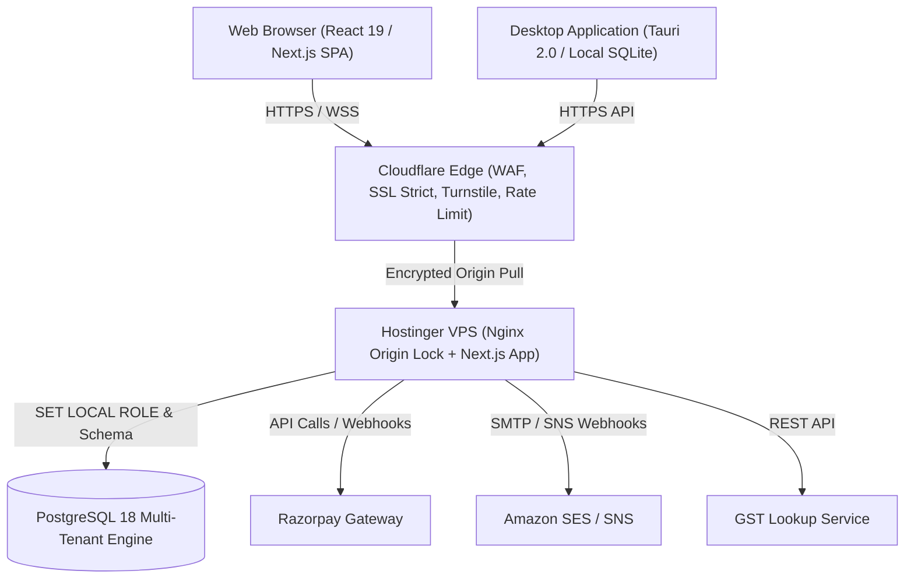
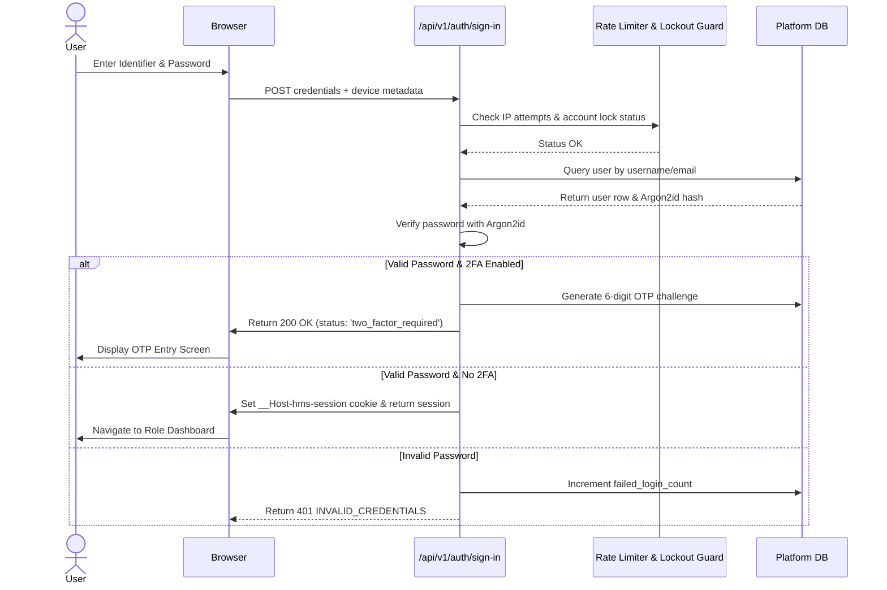

# 18. Complete Architecture Diagrams (Mermaid)

## 1. Overall System Architecture



---

## 2. Authentication & Authorization Execution Flow



---

## 3. Desktop Application Runtime Architecture

```mermaid
graph LR
    subgraph DesktopApp ["Tauri 2.0 Desktop Container"]
        subgraph Webview ["Webview Frontend (Chromium / WebKit)"]
            UIComponents["React 19 UI / Pallav Components"]
            StateMgmt["Local Dashboard State"]
        end
        subgraph Core ["Rust Core Backend"]
            PrinterDriver["ESC/POS Printer Service"]
            ScannerHook["USB HID Scanner Listener"]
            OfflineSync["Sync & Queue Manager"]
            LocalDB[(Embedded SQLite Cache)]
        end
    end

    subgraph Cloud ["Cloud Platform Infrastructure"]
        CloudAPI["HMS Next.js Cloud API"]
        CloudDB[(PostgreSQL 18 Multi-Tenant)]
    end

    UIComponents <-->|Tauri IPC Invoke| Core
    PrinterDriver -->|Raw USB / Network| HardwarePrinter["POS Thermal Printer / Cash Drawer"]
    ScannerHook <--|Input Events| HardwareScanner["Barcode / Passport Scanner"]
    OfflineSync <--> LocalDB
    OfflineSync <-->|Encrypted HTTPS API| CloudAPI
    CloudAPI <--> CloudDB
```
