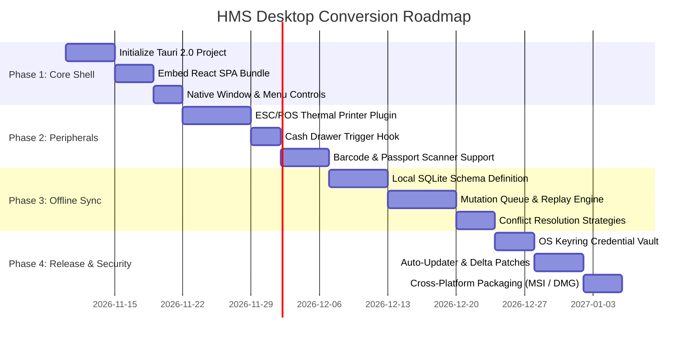

# 19. Desktop Conversion Roadmap & Implementation Plan

This roadmap outlines the systematic phases required to implement the desktop application in `desktop-app/`.

## Phase Breakdown

### Phase 1: Core Shell & Navigation
1. Initialize Tauri 2.0 inside `desktop-app/` with Rust bindings.
2. Configure Next.js static asset export to compile dashboard UI into static files.
3. Implement frameless custom window header styled in graphite design tokens.
4. Integrate OS secure storage (Windows Credential Manager / macOS Keychain) for persistent offline sessions.

### Phase 2: Hardware Peripherals & POS Integration
1. Develop Rust ESC/POS thermal printing module with raw socket and USB endpoints.
2. Build RJ11 cash drawer trigger executed immediately upon invoice settlement.
3. Implement native USB HID keyboard wedge listener for rapid barcode and QR code voucher scanning.

### Phase 3: Local Caching & Offline Synchronization
1. Create local SQLite database mirroring hotel tenant schema tables (`rooms`, `stays`, `rates`, `menu`).
2. Build bidirectional sync engine:
   - Polls cloud API for updates when online.
   - Queues offline check-ins and charges in local storage during network interruptions.
   - Automatically replays mutations with idempotency keys upon connectivity restoration.

### Phase 4: Packaging, Security & Distribution
1. Configure code signing with authentic developer certificates (Microsoft EV Code Signing / Apple Developer ID).
2. Set up automated continuous deployment pipeline producing Windows `.msi` / `.exe` and macOS `.dmg` installers.
3. Enable cryptographic delta auto-updates so front-desk terminals update transparently.
